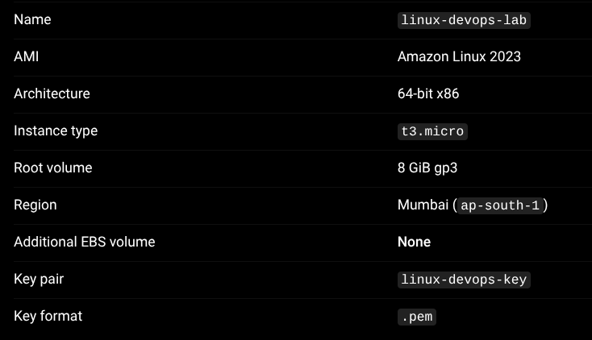
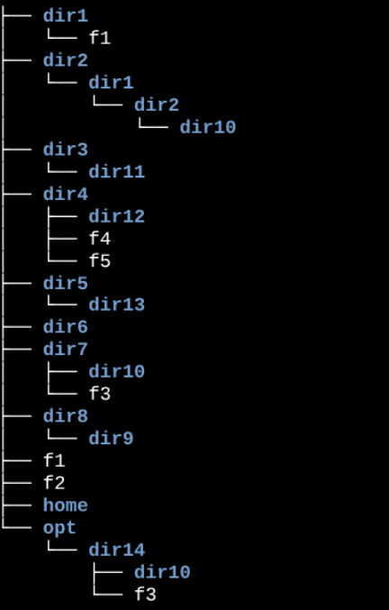

# Linux Administration & AWS DevOps Practical Assessment

## Project Overview

This project demonstrates hands-on experience with Linux System Administration and AWS Cloud Infrastructure using an Amazon Linux 2023 EC2 instance.

The project consists of 11 practical modules covering Linux user and group management, file permissions, directory structures, file operations, text processing, filesystem management, and AWS EBS volume administration.

The objective is to develop practical Linux administration skills and understand how to manage AWS EC2 instances and storage resources.

## Technologies Used

- **Cloud Platform:** Amazon Web Services (AWS)
- **Operating System:** Amazon Linux 2023
- **Compute:** AWS EC2
- **Storage:** AWS EBS
- **Scripting:** Bash
- **Text Editor:** Vi Editor
- **Text Processing:** sed
- **Cloud CLI:** AWS CLI
- **Version Control:** Git and GitHub

## Prerequisites

- AWS account
- Basic Linux command-line knowledge
- Basic understanding of AWS EC2 and EBS
- SSH client or EC2 Instance Connect
- AWS CLI installed (optional for console-based tasks)

## AWS EC2 Configuration

| Configuration | Value |
|---|---|
| Instance Name | linux-devops-lab |
| AMI | Amazon Linux 2023 |
| Architecture | 64-bit x86 |
| Instance Type | t3.micro |
| Root Volume | 8 GiB gp3 |
| Key Pair | linux-devops-key |
| Key Format | .pem |

## Skills Covered

- Linux User and Group Management
- File Permissions and Ownership
- Directory and File Management
- Absolute and Relative Paths
- Linux Shell Commands
- Text Processing using sed
- File Editing using Vi Editor
- Filesystem Creation and Mounting
- AWS EC2 Instance Management
- AWS EBS Volume Creation and Attachment
- AWS Infrastructure Cleanup

## Project Modules

| Module | Description |
|---|---|
| 01 | Linux User, Group and Directory Management as Root |
| 02 | User and Group Management as user1 |
| 03 | File and Directory Management as user4 |
| 04 | Relative Paths and File Operations as user1 |
| 05 | File and Text Management as user2 |
| 06 | File Searching and Text Display as Root |
| 07 | AWS EBS Volume Creation and Attachment |
| 08 | Filesystem Creation and Mounting |
| 09 | File and Directory Cleanup as user5 |
| 10 | User, Group and Filesystem Cleanup as Root |
| 11 | EBS Detachment, Deletion and EC2 Termination |

## Repository Structure

```text
linux-for-cloud-and-devops-engineer/
│
├── README.md
│
├── Linux-Administration/
│   ├── Task.md
│   └── Solution.md
│
└── Screenshots/
    ├── EC2_configuration.png
    └── Folder_structure.png
```

## Documentation

- **Practical Assessment Tasks:** [Task.md](./Linux-Administration/Task.md)
- **Step-by-Step Solutions:** [Solution.md](./Linux-Administration/Solution.md)

## Screenshots

### 1. AWS EC2 Configuration

This screenshot shows the EC2 instance configuration used for the Linux Administration practical assessment.



### 2. Linux Folder Structure

This screenshot demonstrates the Linux directory and file structure created during the practical exercises.



## Learning Outcomes

This project covers the following practical skills and concepts:

- Creating and managing Linux users and groups.
- Managing primary and secondary group memberships.
- Configuring sudo and user privileges.
- Managing file ownership and permissions.
- Creating, moving, renaming and deleting files and directories.
- Working with absolute and relative paths.
- Editing files using Vi Editor.
- Searching and replacing text using sed.
- Searching files using find.
- Managing Linux filesystems and storage devices.
- Creating and attaching EBS volumes to EC2 instances.
- Formatting and mounting EBS filesystems.
- Managing AWS EC2 and EBS resources.
- Cleaning up Linux users, groups and AWS infrastructure.

## Conclusion

This project provides practical exposure to Linux System Administration and AWS Cloud Infrastructure Management through real-world command-line exercises.

It builds a strong foundation for Linux Administration, Cloud Engineering and DevOps practices.

**All done? Still not confident? Repeat the steps!**

